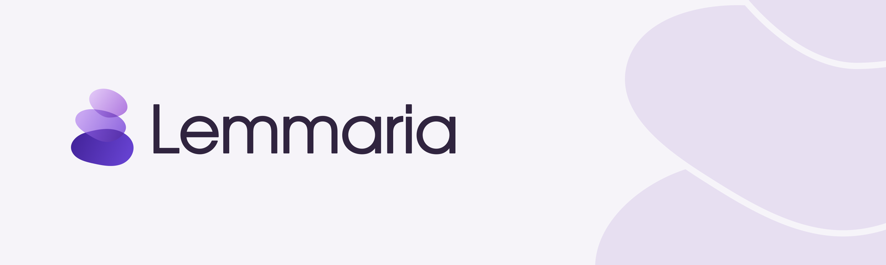

<p align="center">
  
</p>

<p align="center">
  <strong>An AI writing agent for academics.</strong><br>
  Agentic editing, blind review and citation checking for LaTeX and Markdown papers, right inside
  VS Code.
</p>

<p align="center">
  <a href="https://marketplace.visualstudio.com/items?itemName=lemmaria.lemmaria"></a>
  
  <a href="LICENSE"></a>
</p>

---

Lemmaria works on your paper the way a coding agent works on code. It reads your manuscript,
proposes edits you approve one at a time, compiles and checks what it changed, and reviews your
draft the way a program committee would — all from a panel inside VS Code, with the model of your
choice.

## Install

Install **Lemmaria** from the
[Visual Studio Marketplace](https://marketplace.visualstudio.com/items?itemName=lemmaria.lemmaria),
or search for "Lemmaria" in the Extensions view of VS Code. From a terminal:

```sh
code --install-extension lemmaria.lemmaria
```

## Highlights

- **An assistant that knows your document.** Multi-turn sessions you can resume, fork and rewind,
  with `@` references to bring files and selections into context.
- **Quick actions on a selection.** Polish, Proofread, Expand By, Shrink By and Translate, each
  returned as an inline diff you accept or reject.
- **Blind review before you submit.** A panel of independent reviewers reads your manuscript and
  returns a ledger of concerns, each anchored to an exact quote in your text, so you can jump
  straight to it.
- **Citation checking.** Verify your keys against your `.bib`, see what can't be grounded, and
  search the literature through Crossref and arXiv.
- **Compile and read the log.** Run your TeX engine of choice and get its log back as navigable
  findings, each with a suggested fix.
- **Venue templates and Writing Skills.** Start a paper from a bundled venue template, and teach
  Lemmaria your conventions with plain Markdown skill files.
- **English and 中文.** The interface follows your VS Code display language; your own text stays in
  whatever language you wrote it.

For the full tour, see the [extension's page](packages/extension/README.md) and its
[changelog](packages/extension/CHANGELOG.md).

## Nothing is written without your approval

Lemmaria is designed so that it never changes your files behind your back. Every edit arrives as a
diff or a proposal for you to accept, every accepted edit can be rolled back on its own, and the
agent's work is checkpointed so you can restore it in one step. The review panel never writes at
all.

This guarantee lives in the engine rather than the interface, so it holds for every action,
including the ones you write yourself. The agent has no general shell and no open network access:
each capability is a named, bounded tool, scripts run only with your explicit approval, and access
to folders outside your workspace is something you grant, per session.

## Your model, your key

Lemmaria works with any Anthropic-protocol or OpenAI-compatible endpoint, including a model you run
locally. Add one or more in the **Models** tab. Keys are kept in VS Code's secret storage, never in
your settings, and your spend for the current run, today and in total is always one glance away in
the status bar.

Your documents remain yours. What Lemmaria sends to a model goes to the endpoint you configured,
under that provider's own terms.

## Getting started

1. Open a folder that contains a `.tex` or `.md` paper.
2. Open the Assistant panel (`Lemmaria: Open Assistant`) and add a model in the **Models** tab.
3. Select a paragraph and run `Lemmaria: Polish`. You get a diff to review, not a silent write.
4. Run `Lemmaria: Create PAPER.md` to give Lemmaria standing context about your paper.

You'll need VS Code 1.106 or later and an API key for a supported model. Compile checks need a
local TeX distribution, or `tectonic`.

## Feedback

Bug reports, questions and suggestions are very welcome: please open a
[GitHub issue](https://github.com/Jokestv2/Lemmaria/issues). It helps to include what you did, what
you expected and what happened instead, along with your Lemmaria and VS Code versions.

Lemmaria doesn't take outside pull requests. If you'd like to propose a change, describe it in an
issue; [CONTRIBUTING.md](CONTRIBUTING.md) explains why.

## Under the hood

Lemmaria is a pnpm workspace of four TypeScript packages. Only the extension talks to the VS Code
API; the engine beneath it is plain Node, so it is tested without an editor.

| Package | What it is |
| --- | --- |
| [`packages/harness`](packages/harness) | The engine: the agent loop, actions, sessions and budgets. |
| [`packages/adapters`](packages/adapters) | Model-provider and LaTeX adapters. |
| [`packages/cli`](packages/cli) | `lemmaria eval`, a command-line evaluation driver. |
| [`packages/extension`](packages/extension) | The VS Code extension, a thin layer over the engine, bundled with esbuild. |

Building and testing needs Node.js 22 or later and pnpm 9 (`corepack enable`):

```sh
pnpm install
pnpm build
pnpm test              # unit tests (vitest)
pnpm test:ext          # extension-host tests; the first run downloads VS Code (~280 MB)
pnpm lint              # biome
pnpm typecheck
pnpm check:boundaries  # architecture checks
pnpm package:ext       # builds packages/extension/lemmaria-<version>.vsix
```

`pnpm check:boundaries` keeps the architecture honest. It fails if anything outside
`packages/extension` imports `vscode`, if a UI string mixes two display languages, or if the webview
parses a string into DOM (it renders model output under a strict Content Security Policy).

The repository references two private submodules, for design notes and the project website. You
don't need either one: clone without `--recurse-submodules`, and everything above runs without them.

## Licence

Lemmaria is source-available under the [PolyForm Strict License 1.0.0](LICENSE), copyright © 2026
Ke Zhao. You're welcome to install and use it for any noncommercial purpose: your own research and
study, or work at a university, a public research organisation, a charity or a government
institution. The source is published so you can see how Lemmaria works; the licence doesn't extend
to commercial use, to changing the source or to redistributing it, and it grants no rights in the
Lemmaria name or logo. Third-party packages bundled with the extension keep their own licences; see
[THIRD-PARTY-NOTICES](packages/extension/THIRD-PARTY-NOTICES.md).
